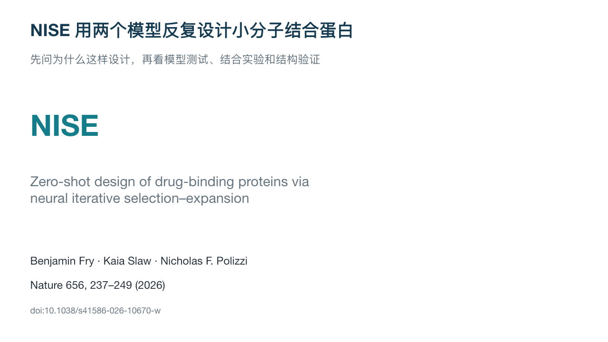

# 计算生物学组会文献讲解 PPT Skill

一个中文 Codex skill：将论文和补充材料制作成 **PPTX + 每页讲者备注 + Markdown 讲稿**。首要目标是把课题组讲懂，而不是堆满术语或把文章压缩成摘要。

Computational biology journal-club skill for Chinese presentations with figure explanations and speaker notes.



## 它强调什么

- 按“提出问题 → 为什么采用策略 → 怎样验证 → 结果怎么解释”讲文章。
- 按听众理解顺序介绍整体、模块及验证，案例先总览再展开。
- 每页一个讲解任务，结果页用具体结论标题，标题和副标题不写问句。
- 主讲与备用分层，按结论组合证据，不强制一图一页。
- 在需要的位置解释实验角色、指标或化学结构，补足读图所需知识。
- 使用正文和图注中的术语，翻译成自然中文；self-consistency 等容易混淆的词保留英文并解释。
- 正文帮助读图，备注写成能自然讲出来的短段落。重排后逐页检查备注、来源与页码匹配。
- 顶部模块导航随文献调整，不固定模块名称或数量。
- 区分预测指标与实验结果、平均值与最佳样本、生成序列与最终实验候选。
- 白底、深蓝标题、青色强调、微软雅黑，论文原图为主；来源放在备注。

默认讲 20–25 分钟，页数按文献决定。适用于蛋白设计、结构预测、计算方法及计算与实验结合的论文；组学和机制论文按其实际问题调整，不强制套用模型开发流程。

## 安装

下载仓库或运行：

```bash
git clone https://github.com/liuxiangyi0420/compbio-journal-club-ppt-skill.git
mkdir -p "${CODEX_HOME:-$HOME/.codex}/skills"
cp -R compbio-journal-club-ppt-skill/skills/compbio-journal-club-ppt "${CODEX_HOME:-$HOME/.codex}/skills/"
```

Windows 可下载 ZIP，将 `skills/compbio-journal-club-ppt` 整个文件夹复制到 Codex 的个人 skills 目录。若已安装同名版本，更新该目录中的文件。

这个仓库包含指令、参考 PPTX 和预览，不是独立的 PowerPoint 生成程序。运行环境需要能读取 PDF、生成带备注的 PPTX，并检查排版。Codex 的 Presentations 工具可承担制作工作；其他环境需提供自己的 PPTX 工具。微软雅黑需由使用者的系统提供，本仓库不分发字体。没有这些工具时仍可复用下面的 prompt，但不能保证生成实际 PPTX。

## 使用

提供论文正文与补充材料，并发送：

> 请使用 $compbio-journal-club-ppt，把这篇文献和补充材料制作成让课题组听懂的中文组会 PPTX，包含每页完整备注和逐页讲稿。汇报 20–25 分钟，直接制作完整版本。

可以补充受众背景、汇报时长或模板要求。无需支持 skill 的环境，可复制 [完整 prompt](skills/compbio-journal-club-ppt/references/reusable-prompt.md)。

## 文件

```text
skills/compbio-journal-club-ppt/
  SKILL.md
  agents/openai.yaml
  references/teaching-standard.md
  references/compbio-reading.md
  references/reusable-prompt.md
  assets/reference.pptx
  assets/preview.png
```

[参考 PPTX](skills/compbio-journal-club-ppt/assets/reference.pptx) 是实际示例，含 20 页主讲、7 页备用和全部讲者备注。只借鉴它的视觉与讲解方式，下一篇论文的页数、图表、结果和讲稿需重新组织。参考文章为 Fry, Slaw & Polizzi, Nature (2026), DOI [10.1038/s41586-026-10670-w](https://doi.org/10.1038/s41586-026-10670-w)。

## 许可

本仓库新编写的 skill 指令、文档和原创排版采用 [MIT License](LICENSE)。参考 PPTX 中的论文图表及论文衍生内容不在 MIT 许可范围内，来源与 CC BY 4.0 说明见 [THIRD_PARTY_NOTICES.md](THIRD_PARTY_NOTICES.md)，PPTX 备注也保留图表来源。生成结果仍需人工核对论文和实验条件。
